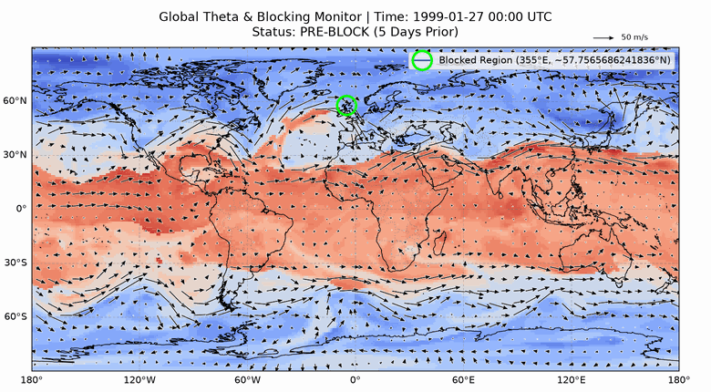
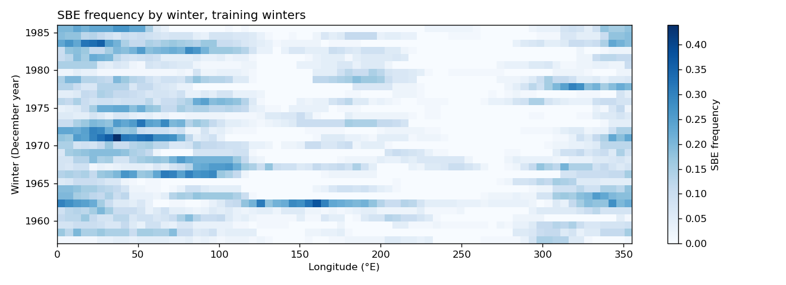
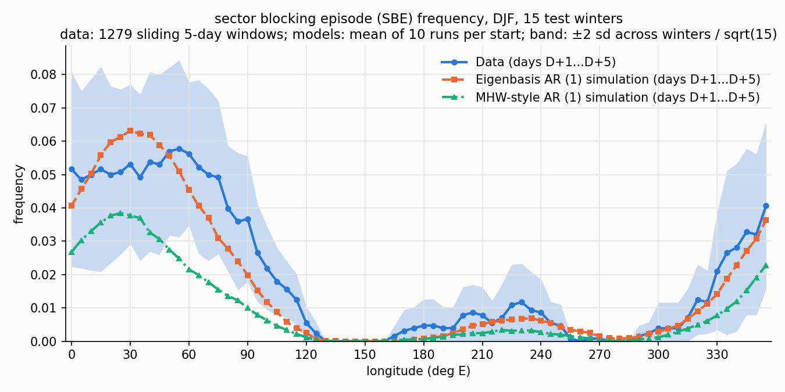
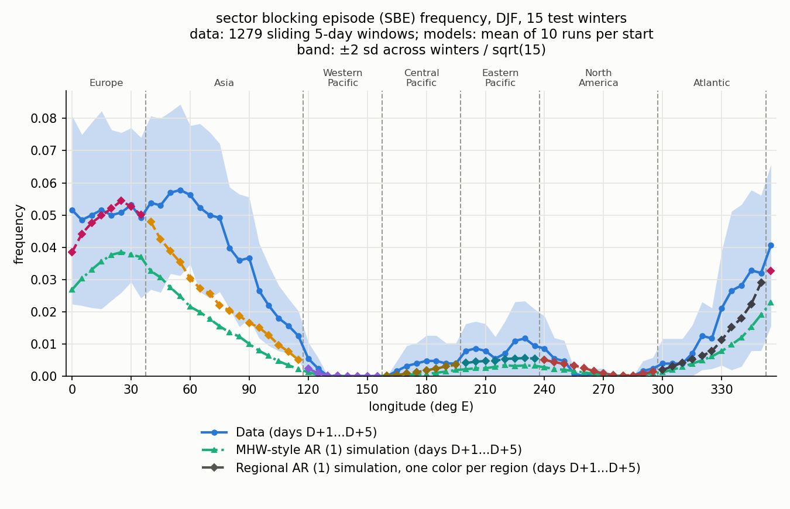
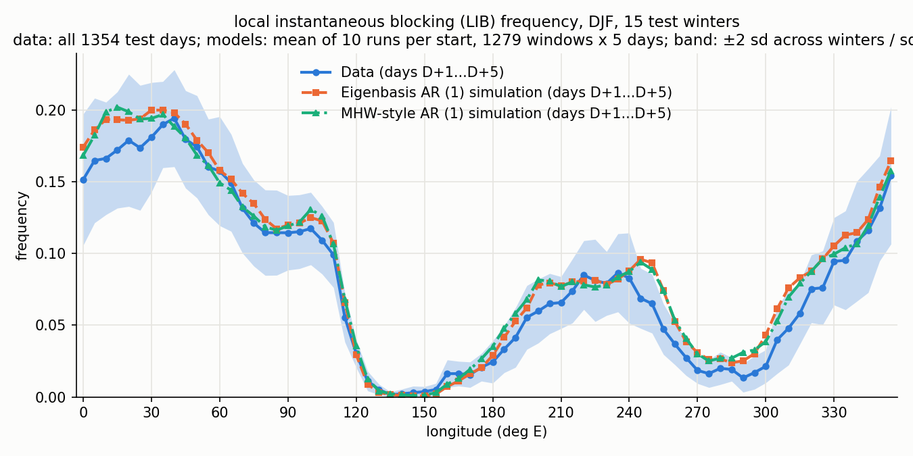
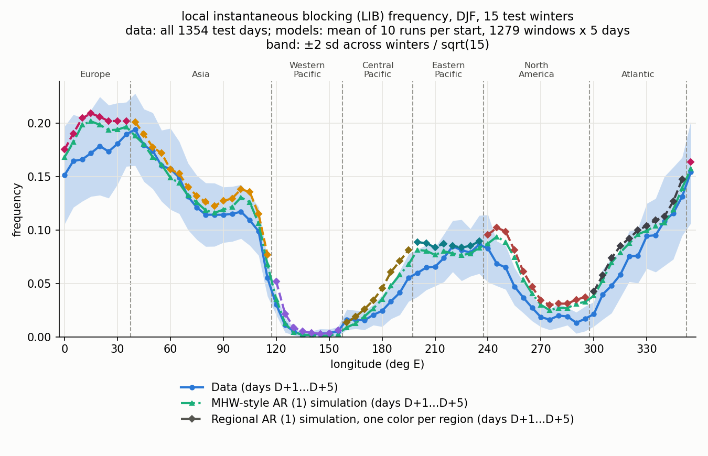
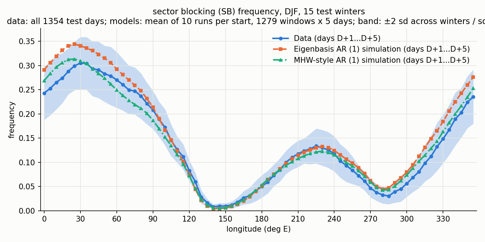
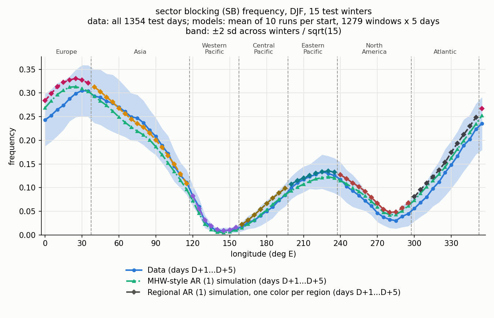

# Modeling Atmospheric Blocking

Matt King, Jun Park, Richard Carini. Erdős Institute data science project, Fall 2026.

<p align="center">
  
  <br>
  <em>A blocking episode in February 1999. Colors show theta on the 2 PVU surface (blue is cold, red is warm), arrows show wind, and the red circle marks the blocked point at 355°E, 58°N.</em>
</p>

We simulate how often blocking occurs at each longitude and score the simulations on 15 winters held out from fitting. We tried two models: a regional AR(1) of the blocking index and an eigenbasis AR(1) of the theta field. Both beat a red-noise baseline on persistent episodes. See [Results](#results).

## The problem

Atmospheric blocking is a sustained, mostly stationary high-pressure system that disrupts the usual west-to-east flow. Blocks are linked to prolonged or extreme regional weather, such as winter cold spells and summer heat waves.

Blocking is measured with an index B, the difference in potential temperature (theta) between the poleward and equatorward sides of a central latitude, on the 2 PVU surface near the tropopause (Tyrlis & Hoskins 2008). B > 0 means the usual north-south pattern has reversed.

**Question:** how well can a simple statistical model reproduce how often blocking occurs at each longitude, especially persistent episodes? Masato, Hoskins & Woollings (2009, "MHW") found that a red-noise AR(1) model of B matches short-lived blocking but underestimates persistent episodes, and attributed the difference to blocks sustaining themselves.

**Why it matters:** if red noise can't explain persistent blocking, the extra persistence needs a physical explanation, and forecasts have room to beat simple statistics. This bears on how atmospheric scientists evaluate blocking in forecast and climate models.

**Scope:** Northern Hemisphere, December-February, ERA-40 reanalysis, 1957-2002. One winter day at one longitude is the unit of analysis (72 longitudes, 0, 5, ..., 355°E). Whole winters are the independent units for splitting and uncertainty, because days within a winter are correlated.

**Out of scope:** forecasting individual blocking events, trends under climate change, other seasons, the Southern Hemisphere, and physics-based simulation.

### Blocking measures

| Measure | Meaning |
|---|---|
| LIB (local instantaneous blocking) | B > 0 at a longitude on a day |
| SB (sector blocking) | A run of 3 consecutive LIB longitudes centered within 20° of a longitude |
| SBE (sector blocking episode) | SB at a longitude on all 5 days of a window |

B uses one fixed central latitude per longitude. The notebooks that reproduce the published results use the published definitions, listed in [evaluation_plan.md](evaluation_plan.md#definitions).

<p align="center">
  
  <br>
  <em>SBE frequency by winter and longitude, training winters, using the published B and SBE. Blocking concentrates near Europe and varies greatly between winters.</em>
</p>

## Method

| Model | Idea |
|---|---|
| Trivial | Each longitude's frequency over the training winters, with no simulation |
| MHW-style AR(1) | Red noise on B with spatially correlated noise, a simplified version of MHW's model |
| Eigenbasis AR(1) | An independent AR(1) for each eigenvector of daily changes in the theta field, with B computed from simulated theta |
| Regional AR(1) | The MHW-style model with one fitted memory value for each of 7 Tyrlis & Hoskins regions |

## Results

RMSE on the 15 test winters, lower is better. SBE is the primary measure.

| Measure | Trivial | MHW-style AR(1) | Regional AR(1) | Eigenbasis AR(1) |
|---|---|---|---|---|
| **SBE** | 0.0123 | 0.0142 | 0.0092 | **0.0064** |
| LIB | 0.0208 | **0.0128** | 0.0186 | 0.0132 |
| SB | 0.0321 | **0.0145** | 0.0192 | 0.0242 |

<table>
  <tr>
    <th>Eigenbasis AR(1) against MHW-style</th>
    <th>Regional AR(1) against MHW-style</th>
  </tr>
  <tr>
    <td></td>
    <td></td>
  </tr>
  <tr>
    <td></td>
    <td></td>
  </tr>
  <tr>
    <td></td>
    <td></td>
  </tr>
</table>

- Both models beat the MHW-style baseline on SBE. The 95% intervals for the RMSE differences are -0.0065 to -0.0011 (regional) and -0.0119 to -0.0006 (eigenbasis).
- The regional and eigenbasis models aren't clearly different on SBE (-0.0010 to +0.0057). The eigenbasis model is clearly better on LIB.
- Regional memory ranges from 0.65 to 0.73, and every value is above MHW-style's fixed 0.62, so the SBE gain can't be credited to differences between regions alone.
- Neither model is clearly better than the trivial baseline on SBE. Fifteen winters leave wide intervals.
- Tomorrow's B depends far more on longitudes to the west than to the east, and none of these models appears able to use this.

All models run for 5 days from observed states, while MHW's model runs freely, so these scores don't directly test MHW's claim. Results are provisional until the [open items](evaluation_plan.md#open-items) are closed.

## Project documents

| Document | Contents |
|---|---|
| [presentation/summary.md](presentation/summary.md) | Executive summary |
| [data_inventory.md](data_inventory.md) | Data sources, access, licensing, limitations |
| [data_audit.md](data_audit.md) | Data audit and feature decisions |
| [kpis.md](kpis.md) | Metrics, formulas, baselines |
| [evaluation_plan.md](evaluation_plan.md) | Definitions, train/test split, leakage review, stress tests, open items |
| [modeling_plan.md](modeling_plan.md) | Models, test results, provisional final choice |
| [schema.json](schema.json) | Inputs, derived features and targets |

## Setup

```bash
conda env create -f environment.yml
conda activate erdos_ds_era40_env
```

In Jupyter or VS Code, select this environment as the notebook's kernel. The data each part needs is below; [data_inventory.md](data_inventory.md) says where to get it.

| To run | You need | Where it goes |
|---|---|---|
| `notebooks/eda.ipynb` | 4 winters of theta and wind | `data_excerpt/`, included in git |
| `notebooks/Model Simulations and Analysis.ipynb` | Daily theta files, 794 MB | Any folder; set `THETA_DIR` in the first code cell |
| `2_dim/2_dim_pipeline.ipynb` | Daily theta files and `B_vals/` | Set `THETA_DIR` in the "1. Folders" cell; put `B_vals/` in the top-level folder |
| Other notebooks | Full ERA-40 files, 31 GB | `data/` |

## Repository layout

| Path | Contents |
|---|---|
| `data_excerpt/` | 4 winters of theta and wind |
| `data/` | Full ERA-40 files (ignored by git) |
| `notebooks/` | Analysis notebooks |
| `2_dim/` | Eigenbasis AR(1) and MHW-style pipeline, with helper modules and outputs |
| `src/` | Scripts |
| `results/` | Saved B values, seasonal central latitudes, model scores |
| `results/eda/` | Audit figures and animations |
| `results/regional_ar1/` | Regional AR(1) scores and figures |
| `episodes/` | LIB, SB and SBE per winter from `src/blocking_episodes.py` |
| `presentation/` | Executive summary |

### Notebooks

| Notebook | Purpose |
|---|---|
| `2_dim/2_dim_pipeline.ipynb` | Trains on 30 winters and tests on 15: eigenbasis AR(1) and MHW-style AR(1) |
| `modeling_baselines.ipynb` | Scores the pipeline's models against the trivial baseline, with bootstrap intervals; writes `results/model_comparison.csv` |
| `Model Simulations and Analysis.ipynb` | Regional AR(1) on the pipeline's B, split and test, scored against the other models |
| `eda.ipynb` | Theta and wind exploration, PCA on theta, blocking animations |
| `data_audit.ipynb` | Completeness of the full files; distributions, outliers, correlations and lag structure of B |
| `feature_selection.ipynb` | What each candidate input adds to predicting tomorrow's B; writes `results/feature_selection.csv` |
| `B Value Computation.ipynb` | B from theta following Tyrlis & Hoskins; writes `results/ERA40_B_index_daily_1957-2002_TH08.parquet` |
| `Blocking Frequencies - Our B vs MHW.ipynb` | Checks LIB, SB and SBE from that B against values digitized from MHW Fig. 2 |
| `repro_MHW.ipynb` | Reproduces the central blocking latitude and tests it against the published curve |
| `Seasonal B Value Computation.ipynb` | Central latitude per season and B computed with it |
| `Drift and Noise Analysis.ipynb` | How the day-to-day change in B depends on B; writes `results/ERA40_winter_B_analysis.sqlite` |
| `pipeline_demo.ipynb` | Placeholder |

### Scripts in `src/`

| Script | Purpose |
|---|---|
| `fetch_era40_uv300_djf.py` | Downloads ERA-40 wind at 300 hPa from GDEX |
| `coarsen_theta_long.py` | Averages theta from 320 to 72 longitudes |
| `blocking_index.py` | B at one central latitude, per month (`B_YYYYMM.nc`) |
| `blocking_episodes.py` | LIB, SB and SBE per winter from those files |
| `plot_era40.py` | Maps of theta and wind; also the GRIB reader used by the notebooks |
| `plot_blocking.py` | Plots of B |
| `plot_sbe_frequency.py` | Frequencies by longitude; holds the digitized MHW curves |
| `check_correlations.py` | Correlations between frequency curves |

Notebooks import these with `sys.path.append("../src")`.

## Command-line tools

Run from the top-level folder.

Plot theta, with or without wind:

```bash
python src/plot_era40.py --theta data_excerpt/theta/theta2pvu_199812.grib --time 1998-12-15T12
python src/plot_era40.py --theta data_excerpt/theta/theta2pvu_199812.grib --uv data_excerpt/uv/uv300_199812.grib --time 1998-12-15T12
```

Plot B from `B_YYYYMM.nc` files made by `src/blocking_index.py`:

```bash
python src/plot_blocking.py B_199812.nc                                        # time x longitude heatmap
python src/plot_blocking.py B_199812.nc B_199901.nc B_199902.nc --out w9899.png  # a whole winter
python src/plot_blocking.py B_199812.nc --day 1998-12-15                       # longitude x central-latitude map for one day
```

Plot and compare blocking frequencies:

```bash
python src/plot_sbe_frequency.py episodes --all               # LIB, SB and SBE by longitude
python src/plot_sbe_frequency.py episodes --all --mhw         # compare with MHW
python src/plot_sbe_frequency.py episodes --all --mhw --cbl   # add the central latitude
python src/check_correlations.py episodes SBE MHW-SBE
python src/check_correlations.py episodes SBE CBL
```

## References

- Masato, G., B. J. Hoskins, and T. J. Woollings, 2009: Can the frequency of blocking be described by a red noise process? *J. Atmos. Sci.*, **66**, 2143-2149.
- Tyrlis, E., and B. J. Hoskins, 2008: Aspects of a Northern Hemisphere atmospheric blocking climatology. *J. Atmos. Sci.*, **65**, 1638-1652.
- Pelly, J. L., and B. J. Hoskins, 2003: A new perspective on blocking. *J. Atmos. Sci.*, **60**, 743-755.
- Woollings, T., et al., 2018: Blocking and its response to climate change. *Curr. Clim. Change Rep.*, **4**, 287-300.
